# Qingyan-ppt-design｜轻研可编辑学术 PPTX 生成 Skill

**Editable Academic PowerPoint Generation Skill · Template Learning**

**学会你的模板，交付可编辑的学术 PPT。**

从论文材料到答辩汇报，轻量驱动、快速生成，让学术表达有据可依，让每一页都能继续修改。

项目仓库：[Gumekn/qingyan-editable-pptx-skill](https://github.com/Gumekn/qingyan-editable-pptx-skill)。核心特征：原生可编辑、学习真实模板、对话快速启动、面向学术表达、轻量 Skill 工作流。

## 1. 安装与快速开始

在 Codex 对话中发送以下安装指令：

```text
$skill-installer

请从 https://github.com/Gumekn/qingyan-editable-pptx-skill 安装 Qingyan-ppt-design。
Skill 位于仓库根目录，请将安装目录命名为 Qingyan-ppt-design。
```

安装器会将仓库根目录中的 `SKILL.md` 和配套资源放入 Codex 用户级技能目录 `~/.codex/skills/Qingyan-ppt-design/`（自定义 `CODEX_HOME` 时使用对应目录），供各项目使用。Skill 名称与安装目录统一为 `Qingyan-ppt-design`，调用方式为 `$Qingyan-ppt-design`。

安装后，在任意项目对话中附上研究材料，直接调用；若尚未识别到技能，重启 Codex 后再试：

```text
$Qingyan-ppt-design

根据我提供的论文、研究材料和配图，制作一份约 8 页的中文学术汇报。
优先使用我提供的 PPTX 模板；没有提供时，请从内置模板中推荐。
最终交付整页 PNG 视觉稿和可编辑 PPTX。
```

## 2. 项目介绍与效果展示

Qingyan-ppt-design（轻研 Slide，简称「轻研」）是一款面向科研与学术汇报的 Codex Skill，通过对话将研究材料转化为学术 PPT。学习真实模板的图文组织、字体、配色与版式，让新内容延续参考风格。支持分阶段确认，交付整页视觉稿与可编辑 PPTX。

以下以 **SafeTraffic Copilot 学术答辩汇报**展示主模板、补充参考与可编辑成品。各组参考图均为制作时实际使用的输入，成品图由交付的 PPTX 在 PowerPoint 中重新渲染。点击图片可查看大图。

### 示例1：技术路线

从主模板学习模块分工、分区标题、输入输出与底部联系，从补充参考学习数据基础与后续分析相邻的组织方式。结合论文已有的完整框架图，安排为左侧大图、右侧分层解释、底部验证说明；保留模板的蓝白配色、黄色栏目标题与字体层级。

| 主模板参考 | 补充组织参考 | 最终效果 · PPTX 实际渲染 |
| --- | --- | --- |
| 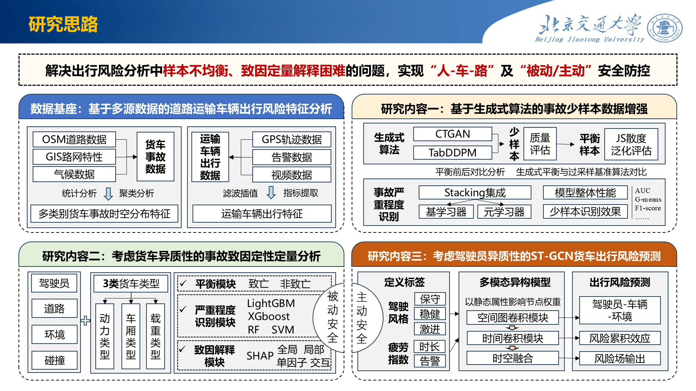 | 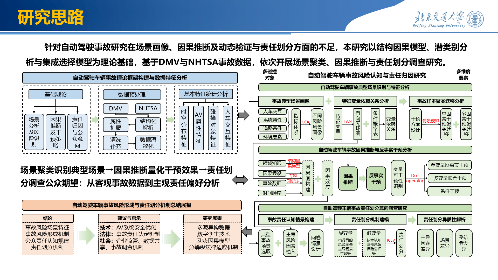 | 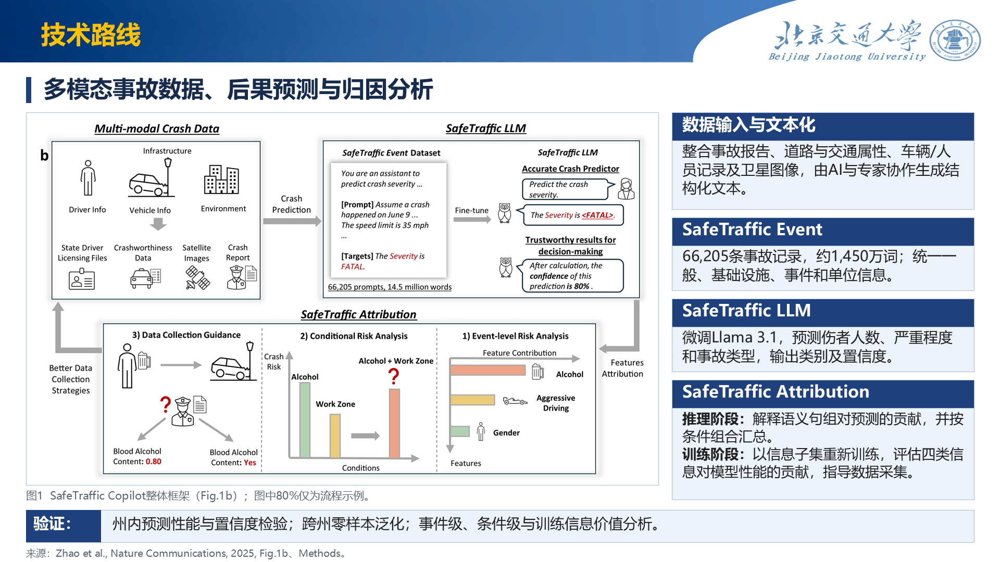 |

在 PowerPoint 中实际渲染的效果如下：

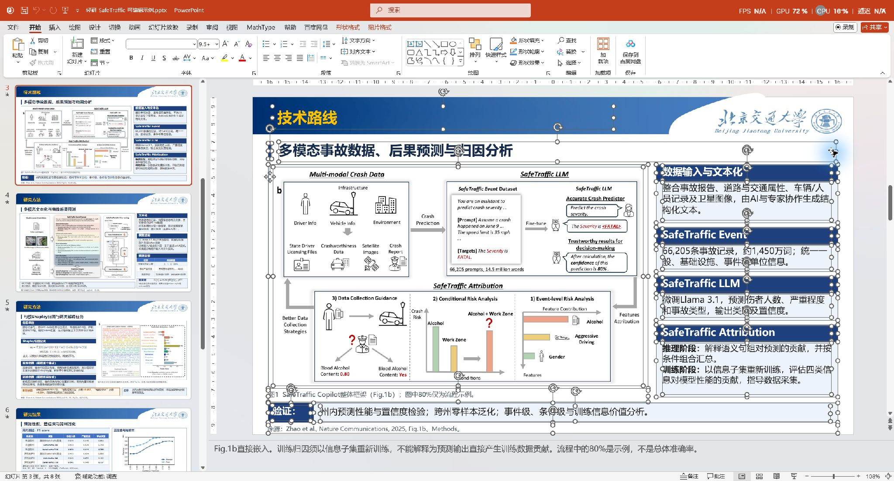

### 示例2：研究方法

从主模板学习机制图与解释段落同组、标题分层，从补充参考学习操作、科学关系与说明就近呈现。将论文三段流程图完整放在左侧，右侧按文本化、模型适配、预测目标和置信度组织说明，数据规模紧邻图下；预测目标重建为原生表格。

| 主模板参考 | 补充组织参考 | 最终效果 · PPTX 实际渲染 |
| --- | --- | --- |
| 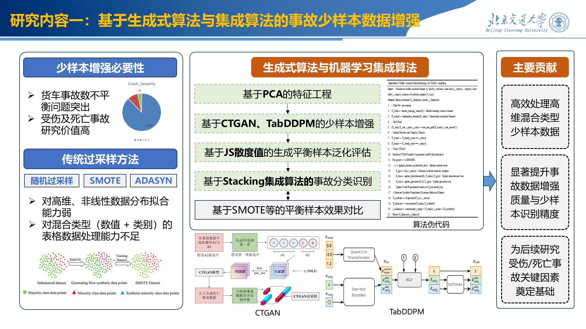 | 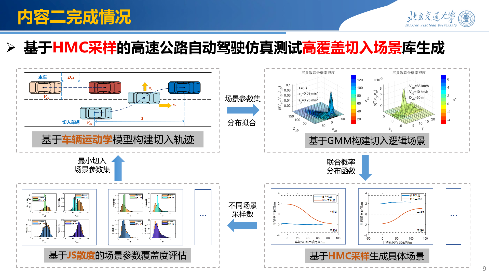 | 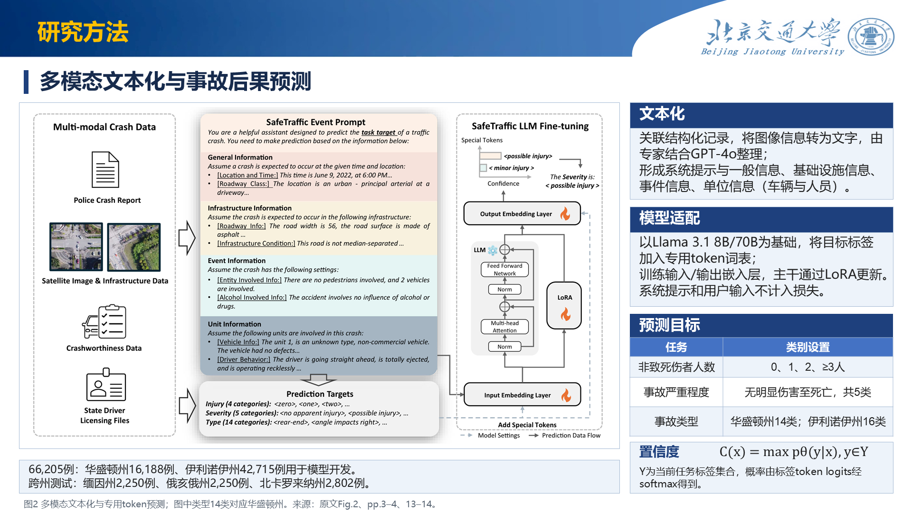 |

在 PowerPoint 中实际渲染的效果如下：

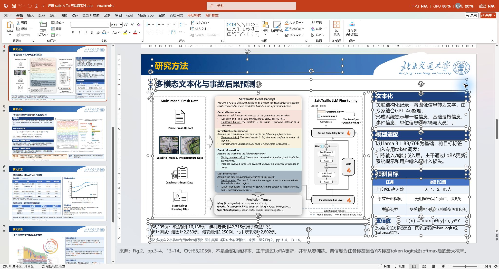

### 示例3：研究结果

从主模板学习表格与多组证据相邻、解释紧靠数据的高密度排版，从补充参考学习定量比较就地解释。成品左侧安排州内与跨州结果表，右侧安排置信度曲线及解释，底部集中交代评估条件；表格采用蓝色表头、浅色隔行与重点数值加粗，保持数字字号一致。

| 主模板参考 | 补充组织参考 | 最终效果 · PPTX 实际渲染 |
| --- | --- | --- |
| 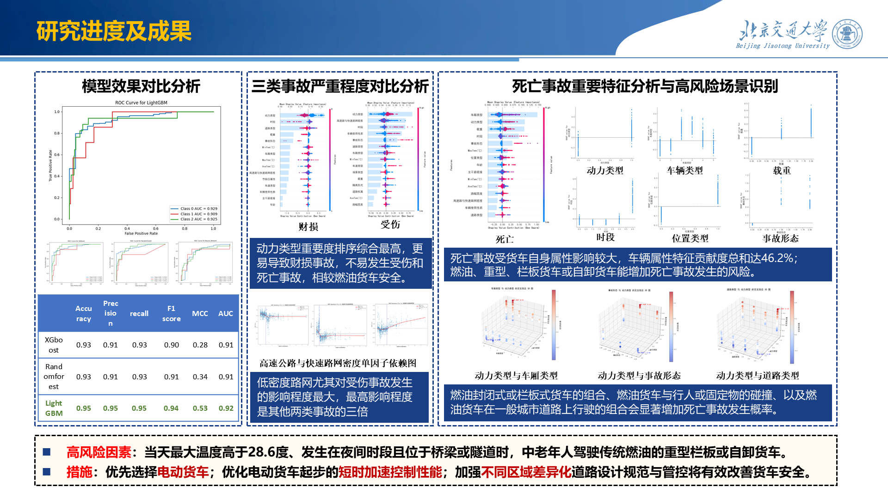 | 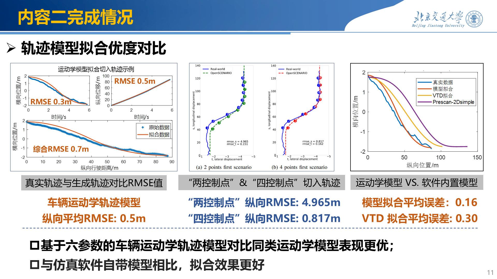 | 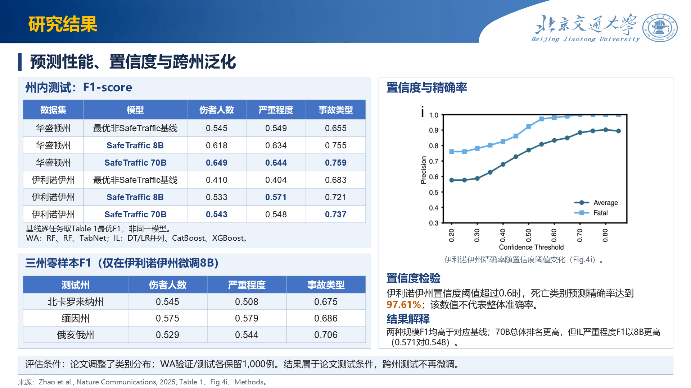 |

在 PowerPoint 中实际渲染的效果如下：

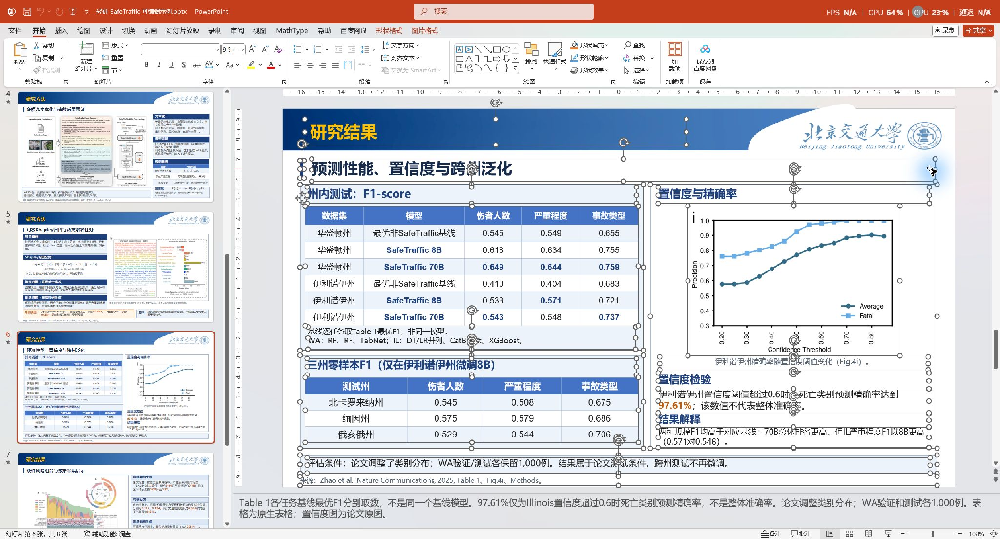

以上编辑截图均在 PowerPoint 画布中按 **Ctrl+A 全选本页组件**后拍摄，可看到文本、表格、图片及形状各自的选中边界。文本内容、表格数据与对象格式可继续修改；论文原图作为独立图片保留，可移动、缩放和替换，图内元素保持原样。

研究材料：Zhao et al., *Nature Communications* (2025), 16:8846，[DOI: 10.1038/s41467-025-64574-w](https://doi.org/10.1038/s41467-025-64574-w)。示例用于展示学术汇报的排版与可编辑交付，研究结论及原图归原论文作者。

## 3. 核心设计：从真实模板中学习

以用户指定模板为主要依据，比较多份 PPT 中的同类页面，学习图文组织、文字层级、配色、版式与留白，形成适合本次材料的设计方案。

本次示例先比较整套模板预览，再按技术路线、方法和结果分别选择主参考与补充参考。生成每张视觉稿时，同时传入真实模板净底板、论文原图、两张参考页和完整文稿，并在提示词中逐项写明借鉴的组织方式及本页如何落实。页眉与标识保留在原位，正文按原图比例和信息量重新安排；参考中的研究内容不带入本次汇报。视觉稿确认后，再将文本、表格和形状重建为可编辑对象，保留独立论文原图，并用 PowerPoint 实际渲染核对。

## 4. 制作流程：输入、阶段与交付

提供论文或研究材料、已有配图，以及汇报用途、页数或时长；有指定模板时一并提供。四个阶段分别展示成果，经用户确认后继续：

| 阶段 | 工作与展示内容 |
| --- | --- |
| 需求与方案 | 理解材料，安排逐页内容，选择模板与参考方向 |
| 文稿与素材 | 展示完整上屏文稿、拟用配图和模板净底板 |
| 整页视觉稿 | 先确认代表页方向，再展示完整页面 PNG |
| 可编辑交付 | 重建 PPTX，展示实际渲染与可编辑性，确认交付版本 |

产物保存在指定任务目录：`配图素材/` 保存选定原图，`视觉稿/` 保存整页 PNG，`可编辑版本/` 保存 PPTX 及渲染预览，`content-plan.md` 记录方案、来源与确认结果。文本、表格、流程等按可编辑对象重建；直接使用的论文原图与复杂插图保留为独立图片。

## 5. 配套模板与运行环境

内置四套 PPTX 模板，配有整套预览、逐页 PNG 和文字索引。用户指定模板决定主要风格与固定格式，其他参考提供补充。

| 模板 | 原始 PPTX | 整套预览 |
| --- | --- | --- |
| 模板1 | [下载](assets/visual-references/模板1/模板1.pptx) | [查看](assets/visual-references/模板1/preview.png) |
| 模板2 | [下载](assets/visual-references/模板2/模板2.pptx) | [查看](assets/visual-references/模板2/preview.png) |
| 模板3 | [下载](assets/visual-references/模板3/模板3.pptx) | [查看](assets/visual-references/模板3/preview.png) |
| 模板4 | [下载](assets/visual-references/模板4/模板4.pptx) | [查看](assets/visual-references/模板4/preview.png) |

完整流程需要具备本地文件读写、ImageGen 生图和 PPTX 编辑能力的 Codex 环境；实际 PPTX 渲染优先使用 Microsoft PowerPoint。这些工具由运行环境提供，本项目提供 [Skill 工作流程](SKILL.md) 与配套模板资源。
